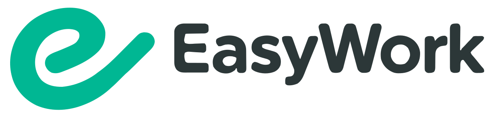

<p align="center"></p>

EasyWork 是基于官方 DeepSeek Harness 的个人 AI 工作台，包含 Web 和 Electron 桌面端，共享项目、资料库、专家、技能和连接器功能。

此仓库是 EasyWork 的源码起点，尚未发布 EasyWork 安装包。官方运行时版本由 [upstream.json](upstream.json) 锁定；桌面端只承载已发布的官方运行时。

需要 Node.js `^22.19.0` 或 `>=24.0.0`，并启用 Corepack。

```sh
corepack yarn install --immutable
corepack yarn check
corepack yarn dev
```

Web 使用独立的 pnpm 工作区：

只运行 Web 调试可在仓库根目录执行 `./scripts/dev-web.ps1`（Windows）或 `bash scripts/dev-web.sh`（macOS/Linux）。首次运行会安装 Web 依赖、构建共享插件并准备独立预览 Profile，然后在本机端口 `18989` 提供服务。打开终端输出的完整带 `token` 地址，按 Ctrl+C 停止。修改源码后重新运行即可更新插件。已有预览可用 `./scripts/dev-web.ps1 -SkipSetup -Port 19000` 或 `bash scripts/dev-web.sh --skip-setup --port=19000` 跳过准备。也可使用 `corepack yarn dev:web`。

```sh
cd apps/web
corepack pnpm install --frozen-lockfile
corepack pnpm build
corepack pnpm typecheck
corepack pnpm preview:install
corepack pnpm preview
```

Windows x64 本地打包在 Windows PowerShell 中执行：

```powershell
.\scripts\build.ps1
# 默认只构建免安装目录，完成后直接运行
.\apps\desktop\dist\win-unpacked\EasyWork.exe
# 需要安装包时单独构建
.\scripts\build.ps1 -Target installer
```

脚本默认安装锁定依赖、构建当前源码的 Web/共享插件、运行完整 Desktop 检查、准备官方运行时，并仅生成 `apps/desktop/dist/win-unpacked/` 免安装目录。直接运行其中的 `EasyWork.exe` 即可测试，无需安装，也无需每次启动重新解压。必须保留整个目录及其 `resources`、DLL 等文件，不能单独复制 EXE；需要分享测试包时可压缩整个目录，接收方解压一次后运行。个人数据仍由现有个人 Profile 管理。只有指定 `-Target installer` 才生成 `EasyWork-<版本>-x64-Setup.exe`。依赖已安装时可加 `-SkipInstall`；`-Help` 查看用法。也可执行 `corepack yarn build:win`。临时 Profile 档案用完即清理，准备的运行时复用固定目录，不累积新的候选副本。构建保持无界面，不提交、发布或启动应用；本地包未签名，正式发布仍走现有发行校验流程。Windows 包须在原生 Windows x64 环境构建。

Logo 原稿和配色位于 `assets/brand/`。运行 `node scripts/generate-brand-assets.mjs` 同步矢量资源，桌面构建会自动生成各平台图标。

许可证见 [LICENSE](LICENSE)，第三方组件声明见 [THIRD_PARTY_NOTICES.md](apps/desktop/THIRD_PARTY_NOTICES.md)。
